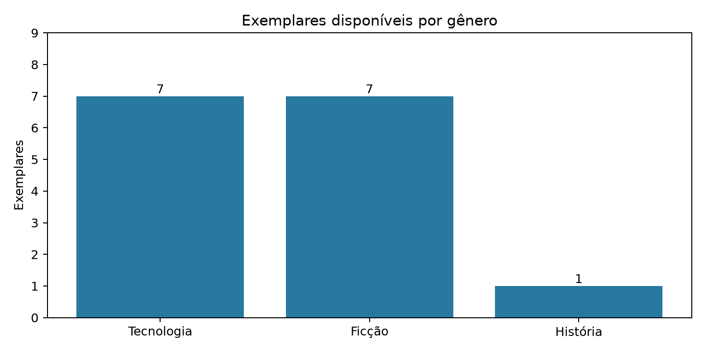
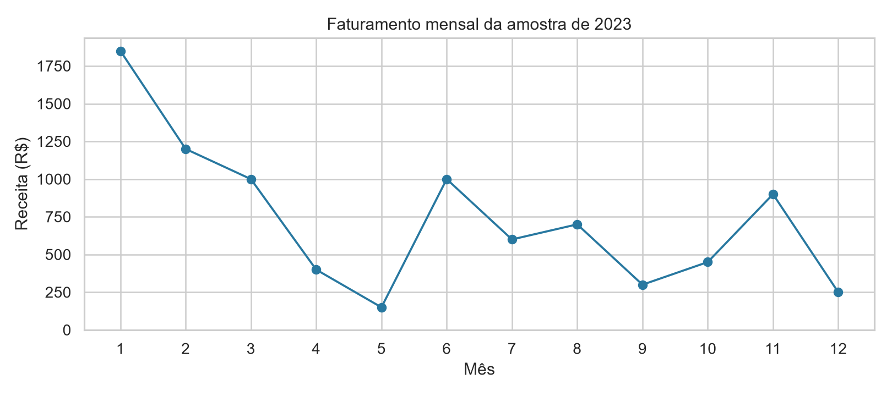
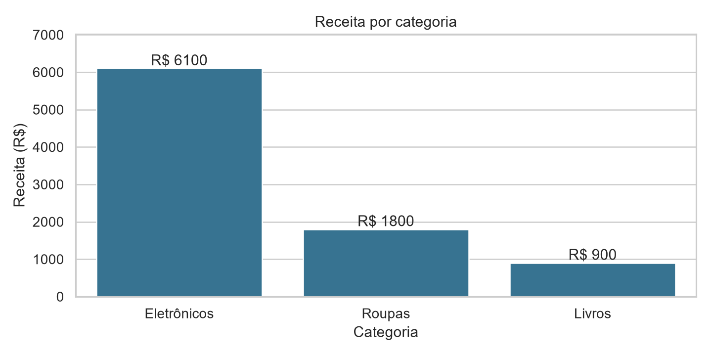
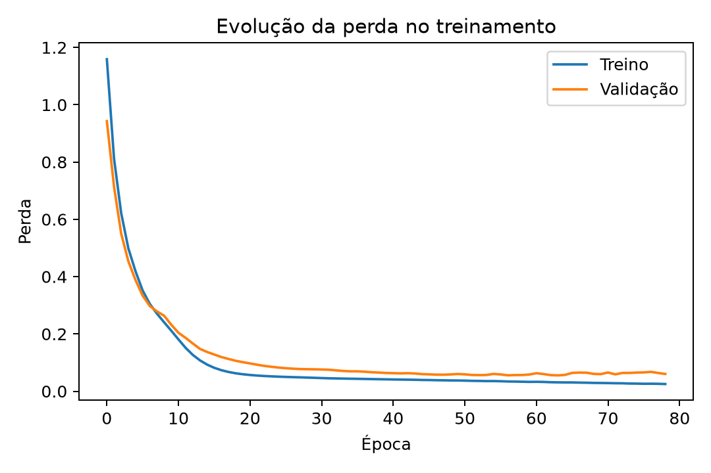

# Python na prática

**Do cadastro de livros à análise de vendas e à classificação de flores com uma rede neural.**


Três projetos da disciplina **Linguagem de Programação**, com código comentado, notebooks executados, gráficos, verificações de funcionamento e relatórios em PDF.

**Aluno:** Gabriel das Chagas Silva · **Instituição:** Anhanguera · **Curso:** Engenharia de Software

## Explore os projetos

| Projeto | O que faz | Tecnologias | Notebook |
| :--- | :--- | :--- | :--- |
| [01 · Biblioteca](atividades/01-biblioteca) | Cadastra livros, lista exemplares disponíveis, busca títulos e gera gráfico por gênero | Classes, listas, funções, Matplotlib | [Abrir no Colab](https://colab.research.google.com/github/gabrielchagas-dev/python-na-pratica/blob/main/atividades/01-biblioteca/U2_A4.ipynb) |
| [02 · Vendas](atividades/02-vendas) | Consulta SQLite, prepara dados, calcula indicadores e compara receitas | SQLite, Pandas, Matplotlib, Seaborn | [Abrir no Colab](https://colab.research.google.com/github/gabrielchagas-dev/python-na-pratica/blob/main/atividades/02-vendas/U3_A4.ipynb) |
| [03 · Machine Learning](atividades/03-machine-learning) | Treina uma rede neural para classificar três espécies de flores Iris | TensorFlow/Keras, scikit-learn, Pandas, NumPy | [Abrir no Colab](https://colab.research.google.com/github/gabrielchagas-dev/python-na-pratica/blob/main/atividades/03-machine-learning/U4_A4.ipynb) |

## Resultados registrados

### 01 · Gerenciamento de livros

O sistema mantém **6 títulos cadastrados**, dos quais **5 possuem exemplares disponíveis**, somando **15 exemplares**. A busca aceita variação entre maiúsculas e minúsculas e espaços nas extremidades. Cadastros com campos obrigatórios vazios ou quantidades inválidas são rejeitados.



O gráfico soma **exemplares**, não títulos. Os livros e autores da demonstração são fictícios. Os cadastros ficam em memória; o JSON contém o resumo da execução.

### 02 · Análise de vendas

| Indicador | Resultado |
| :--- | ---: |
| Receita total | R$ 8.800,00 |
| Registros de venda | 14 |
| Ticket médio | R$ 628,57 |
| Participação de Eletrônicos | 69,32% |

<table>
<tr>
<td width="50%"></td>
<td width="50%"></td>
</tr>
</table>

Os dados de **2023** são os 14 registros fornecidos no roteiro. Eles permitem demonstrar consultas, agrupamentos e visualizações; essa amostra pequena não comprova sazonalidade. Receita não representa lucro, pois não há custos na base.

### 03 · Classificação Iris

A rede possui quatro entradas, camadas ocultas com 16 e 8 neurônios e saída com três classes. A divisão estratificada reservou **96 flores para treino, 24 para validação e 30 para teste**. A padronização foi ajustada apenas no treino, e a validação orientou a parada antecipada.

Na execução registrada, o modelo treinou por **79 épocas** e acertou **29 das 30 flores do teste**, com **96,67% de acurácia**.



| Classe real / prevista | Setosa | Versicolor | Virginica |
| :--- | ---: | ---: | ---: |
| Setosa | 10 | 0 | 0 |
| Versicolor | 0 | 9 | 1 |
| Virginica | 0 | 0 | 10 |

O resultado se refere a essa divisão específica. Versões e plataformas podem alterar o treinamento. As probabilidades softmax não garantem confiança calibrada.

## Execute no Google Colab

Use os links **Abrir no Colab** da tabela e selecione **Ambiente de execução → Executar tudo**. Os notebooks preservam as saídas da execução local de 13/10/2026. A execução original não ocorreu no serviço Colab.

Se uma biblioteca estiver ausente, execute esta célula antes do código:

```python
%pip install matplotlib seaborn pandas scikit-learn tensorflow
```

## Execute no computador

Recomendado: **Python 3.12**. As versões usadas estão em [requirements.txt](requirements.txt).

```powershell
git clone https://github.com/gabrielchagas-dev/python-na-pratica.git
cd python-na-pratica
python -m venv .venv
.\.venv\Scripts\python.exe -m pip install -r requirements.txt
```

Execute cada script dentro da própria pasta para manter seus arquivos de resultado organizados:

```powershell
# Projeto 1
cd atividades/01-biblioteca
..\..\.venv\Scripts\python.exe biblioteca.py

# Projeto 2
cd ../02-vendas
..\..\.venv\Scripts\python.exe vendas.py

# Projeto 3
cd ../03-machine-learning
..\..\.venv\Scripts\python.exe iris_modelo.py
```

Os gráficos são exibidos e salvos em PNG. Os scripts também gravam resultados em JSON. O programa de vendas reinicia a tabela demonstrativa `vendas1` do banco `dados_vendas.db` da pasta corrente para evitar duplicação dos exemplos; mantenha a execução na pasta dedicada.

O arquivo `modelo_iris.keras` contém o modelo treinado. Para inferência em outro programa, é necessário preservar também os parâmetros do `StandardScaler` e a ordem das características. A execução do notebook recria esses elementos.

## Relatórios e estudo

- [U2 A4 · Bibliotecas e módulos](relatorios/GabrielChagas_LP_U2_A4.pdf)
- [U3 A4 · Visualização de dados](relatorios/GabrielChagas_LP_U3_A4.pdf)
- [U4 A4 · Machine Learning](relatorios/GabrielChagas_LP_U4_A4.pdf)
- [Guia de estudo com explicações e exercícios](docs/guia-de-estudo.md)

Os PDFs incluem capa, folha de rosto, código completo, respostas às questões do roteiro, gráficos e capturas reais dos notebooks executados.

## Organização

```text
python-na-pratica/
├── atividades/
│   ├── 01-biblioteca/         # Código, notebook, gráfico e resultados
│   ├── 02-vendas/            # Código, notebook, SQLite e gráficos
│   └── 03-machine-learning/  # Código, notebook, modelo e avaliação
├── docs/
│   └── guia-de-estudo.md
├── relatorios/              # Três entregas em PDF
├── requirements.txt
└── README.md
```

## Verificações realizadas

| Projeto | Conferências |
| :--- | :--- |
| Biblioteca | Busca, títulos disponíveis, exemplares por gênero e rejeição de cadastros inválidos |
| Vendas | Tipos, valores ausentes, duplicatas, valores negativos, quantidade de registros e totais |
| Iris | Divisão dos dados, média do treino padronizado, probabilidades e matriz de confusão |

As verificações estão no código e as saídas nos notebooks e arquivos `execucao.txt`. Os três notebooks concluíram sua execução sem células com erro.

## Documentação das ferramentas

[Python](https://docs.python.org/3/) · [Pandas](https://pandas.pydata.org/docs/) · [Matplotlib](https://matplotlib.org/stable/) · [Seaborn](https://seaborn.pydata.org/) · [TensorFlow](https://www.tensorflow.org/tutorials) · [scikit-learn](https://scikit-learn.org/stable/)
